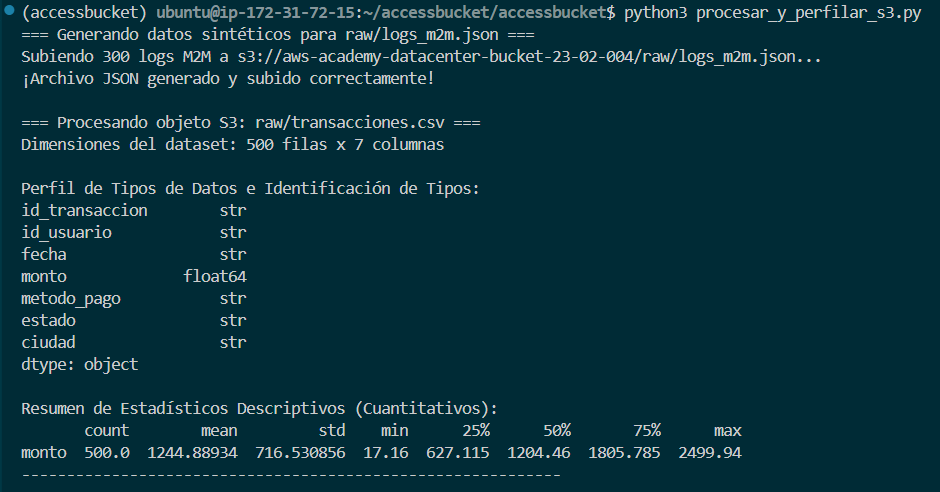
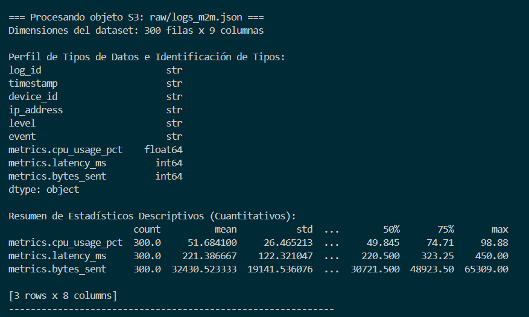
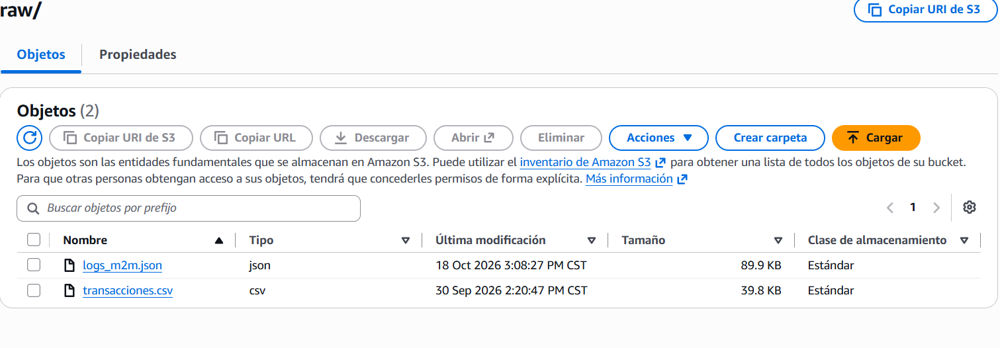

# Perfilamiento e Ingesta Multi-Fuente en AWS S3 con Python

Práctica 1 – Extraction Knowledge. Descarga un CSV y un JSON desde un bucket de AWS S3 directamente
a memoria (`io.BytesIO`, sin guardar en disco) y genera un perfilamiento básico con pandas.

## Estructura

```
.
├── img/                          # Capturas de la ejecución
├── reporte/                      # Reporte técnico (PDF) y portada
├── .gitignore                    # Excluye credenciales, entornos virtuales y datos locales
├── procesar_y_perfilar_s3.py     # Script principal
├── README.md
└── requirements.txt              # boto3, pandas
```

## Uso

```bash
python3 -m venv venv
source venv/bin/activate          # En Windows: venv\Scripts\activate
pip install -r requirements.txt

# Credenciales temporales de AWS Academy (nunca en el código):
export AWS_ACCESS_KEY_ID=<access key>
export AWS_SECRET_ACCESS_KEY=<secret key>
export AWS_SESSION_TOKEN=<session token>

python3 procesar_y_perfilar_s3.py
```

Opcional: `export S3_BUCKET_NAME=<nombre del bucket>` para usar otro bucket.

## Resultados

| Archivo | Filas x columnas |
|---|---|
| `raw/transacciones.csv` | 500 x 7 |
| `raw/logs_m2m.json` | 300 x 9 |




